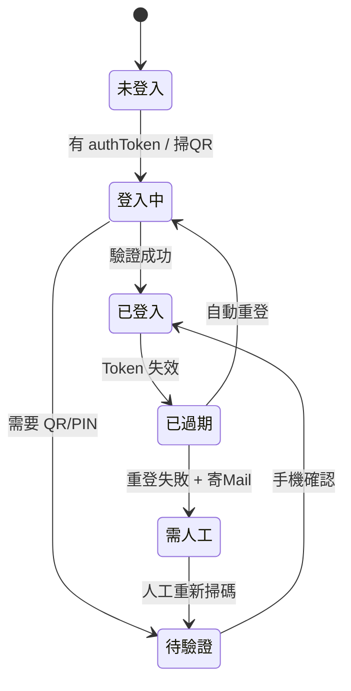

# ImHook 轉發器 — 架構

將外部端點傳來的訊息，透過一個已登入的 LINE 帳號（selfbot）轉發給指定的好友或群組。

> 注意：使用非官方 LINE API（linejs）屬 selfbot，違反 LINE 服務條款，帳號有被停權風險。

## 技術選型

- 語言：TypeScript + Node.js
- LINE 用戶端：`@evex/linejs`（JSR）
- Webhook / 狀態頁：Express 或 Fastify（單一 process、單一 port 不同路由）
- Email 通知：`nodemailer`
- 對外通道：ngrok 或 Cloudflare Tunnel

## 系統流程圖

```mermaid
flowchart TD
    subgraph Boot["① 啟動階段"]
        A[讀取 config<br/>port / 允許IP / HMAC密鑰 / SMTP / 帳號] --> B{有有效 authToken?}
        B -- 有 --> C[登入 LINE 帳號]
        B -- 無 / 過期 --> D[產生 QR / PIN<br/>顯示於 console]
        D --> C
        C --> E[抓好友/群組<br/>建立 mid 對照表]
        E --> F[啟動 Webhook :8090]
        E --> G[啟動 狀態頁 :8090/status]
        E --> H[啟動 Token 健康監控]
    end

    subgraph Webhook["② 接收 / 轉發"]
        W1[收到 POST] --> W2{來源 IP 允許?}
        W2 -- 否 --> W9[403 + log]
        W2 -- 是 --> W3{驗證 (HMAC / URL Token / Bearer)?}
        W3 -- 否 --> W9
        W3 -- 是 --> W4[解析 to / 訊息內容 / 模板+變數 / 排程]
        W4 --> W5{找到目標 mid?}
        W5 -- 否 --> W10[404 + log]
        W5 -- 是 --> W6[getChat mid .sendMessage]
        W6 --> W7{發送成功?}
        W7 -- 是 --> W8[200 + log]
        W7 -- 否 --> W11[重試 → 500 + log]
    end

    subgraph Monitor["③ Token 監控（定時）"]
        M1[檢查登入狀態] --> M2{Token 有效?}
        M2 -- 是 --> M3[狀態頁: 綠燈 正常]
        M2 -- 否 --> M4[嘗試自動重登]
        M4 --> M5{重登成功?}
        M5 -- 是 --> M3
        M5 -- 否 --> M6[寄 Email 通知]
        M6 --> M7[狀態頁: 紅燈<br/>顯示 QR / PIN]
    end

    subgraph Status["④ 狀態頁 :8090/status"]
        S1[登入狀態 + 最後發送時間]
        S2[最近 log 列表]
        S3[正常綠燈 / 過期紅燈 + QR]
    end

    F --> W1
    H --> M1
    G --> Status
    M3 --> Status
    M6 --> Status
```

## 登入狀態機



## Webhook 介面

### 請求

```http
POST /webhook HTTP/1.1
Content-Type: application/json
X-Signature: <HMAC-SHA256(body, secret)>   # 或 ?token=<WEBHOOK_TOKEN> / Authorization: Bearer <API_TOKEN>

{
  "to": "好友名稱或 mid",           // 或陣列
  "text": "要轉發的訊息",            // 可選
  "template": "模板名稱",            // 可選（搭配 vars）
  "vars": { "name": "小明" },        // 可選
  "sticker": { "packageId": "446", "stickerId": "1988" },  // 可選
  "location": { "latitude": 25.03, "longitude": 121.56 },  // 可選
  "flex": { "altText": "通知", "contents": { "type": "bubble" } }, // 可選
  "sendAt": "2026-01-01T09:00:00+08:00",  // 可選（或 delaySec）
  "delaySec": 60                          // 可選
}
```

### 回應

| 狀態碼 | 意義 |
| --- | --- |
| 200 | 發送成功 |
| 400 | 參數格式錯誤 |
| 403 | 來源 IP 不在允許清單，或 HMAC 簽章錯誤 |
| 404 | 找不到目標好友 / 群組 |
| 500 | LINE 發送失敗（已重試） |

## 狀態頁

- 路由：`GET /status`（與 webhook 同一個 process / port）
- 顯示內容：
  - 登入狀態（綠燈正常 / 紅燈過期）
  - 過期時顯示 QR / PIN 供人工重新驗證
  - 最後一次發送時間與目標
  - 最近 N 筆 log（時間、來源 IP、目標、成功/失敗、錯誤原因）

## 告警通知（C2）

- 觸發時機：任一平台 `healthCheck()` 失敗（含「需人工」）、恢復、死信累積超過閾值。
- **去抖重發**：同一事由首次立即、之後每 `ALERT_RESEND_MINUTES`（預設 30）分鐘；恢復另發「已恢復」通知。
- **通道（彼此獨立，單一失敗不影響其他）**：
  - Email（`SMTP_*`，`notify/mailer.ts` 的 `sendMailChecked` 回報是否送達）
  - Webhook（`ALERT_WEBHOOK_URLS`，`notify/alert.ts`）——同一份 JSON 相容 Slack（`text`）／Discord（`content`）／ntfy（`title`＋`message`）
  - 兩者都沒設定 → 只寫 log 並記 error（`sendAlert` 會在「全部失敗」時記 error）
- **dead-man's switch**：`ALERT_DEADMAN_URL`，每輪健康檢查 ping 一次；程序掛掉就不會 ping，由外部 uptime 服務逾時告警——解決「SMTP 壞了所以沒人知道 SMTP 壞了」。
- 監控主體：`monitor/token.ts` 走 `listServices()`（所有平台），依賴可注入（`MonitorDeps`）供測試。
- 設定可於 `/settings` →「監控 / Log」線上修改（`settings.json` 的 `alert` 區塊）。

## 健康探針

- `GET /healthz`：**liveness**，行程活著就 200（不呼叫任何平台）；Docker `HEALTHCHECK` 與負載平衡器用這個。
- `GET /health`：**readiness**，逐平台 `healthCheck()`，任一異常回 503；供監控判斷「平台是否可用」。
- 平台掛掉時不應重啟容器（那是 recover 的責任），所以 HEALTHCHECK 指向 `/healthz`。

## 注意事項

- **登入不可省**：核心是已登入的 LINE client；`authToken` 過期須能自動重登，否則轉發會靜默失敗。
- **狀態回饋**：webhook 需同步回傳實際發送結果，呼叫方才能判斷成敗。
- **目標解析**：好友名稱可能重複，建議優先使用 `mid`；支援名稱時需處理「找不到 / 多筆」。
- **安全性**：IP 白名單可被偽造/共用，建議搭配 HMAC 簽章驗證。
- **重試**：LINE 發送遇暫時性錯誤應重試，並記錄於 log。

## 多平台（IM）支援

### 傳輸抽象層

- `src/messaging/types.ts`：`Platform`、`IMessagingService`、`IncomingMessage`、`ChatTarget`。
- `src/messaging/services.ts`：服務註冊表（`registerService` / `getService` / `listServices`）。
- `src/messaging/dispatch.ts`：共用的收訊管線（指令 → 技能 → 轉發規則），吃 `DispatchDeps`。
- 各平台 adapter（`src/line/client.ts`、`src/telegram/client.ts`…）實作 `IMessagingService`，
  只負責傳輸；`index.ts` 在啟動時 `registerService()`。

### 平台歸屬對照表（顯示與設定分離的依據）

> 規則：**只有某個 IM 才用得到的設定/UI，一律標 `data-im="<平台>"`**；共用者不標。
> 設定頁、Console、Dashboard 都靠 `[data-im]` + 右上角全域切換（localStorage `lw_platform`）自動過濾。

| 歸屬 | 設定欄位 / UI |
| --- | --- |
| **共用** | 安全/來源（allowedIps、hmac*、webhookToken*、apiToken*、adminPrivateOnly、rateLimit*）；發送/重試（send.*、replyMaxChars）；監控/Log（timezone、healthCheckIntervalSec、log*、messagesPersist）；訊息模板 `templates`（純文字）；訊息轉發規則 `forward`；指令 `commands`；Email `smtp.*`；匯出/匯入；語言；技能頁 `assistant` + `skills`；Console 的測試發送、目標清單、最近紀錄、排程；Dashboard 的狀態摘要與發送統計 |
| **LINE 專屬** | 設定：`line.mode`（personal／official 擇一）/ `storagePath`（session 檔，個人帳號）/ `device` / `deviceName` / `modelName`、`targets`（mid）、**Flex 樣板 `flexTemplates`**；「儲存並重新登入」按鈕（原在 Console 操作）；Console：Flex 可視化編輯器、操作（重新整理聯絡人）；Dashboard：QR / PIN |
| **LINE 官方模式** | 同一個 platform id `line`，由 `line.mode` 與 selfbot **擇一啟用**（仿 WhatsApp cloud/web）：`line.official.*`（`channelAccessToken` / `channelSecret` / `webhookUrl` / `targets`，userId・groupId）。接收 `POST /line-official/webhook` 驗 `X-Line-Signature`；本機媒體需 `MEDIA_PUBLIC_URL` 才能變成 LINE 可抓取的簽章連結（`/media/:exp/:sig/:name`）。取捨：兩模式共用統計與排程檔，切換後目標 ID 需重填 |
| **Telegram 專屬** | 設定：`telegram.enabled` / `botToken` / `secretToken` / `webhookUrl` / `telegram.targets`（chat_id） |
| **WhatsApp 專屬** | 設定：`whatsapp.enabled` / `mode`（cloud\|web）/ `phoneNumberId` / `accessToken` / `verifyToken` / `appSecret` / `apiVersion` / `webAuthPath` / `whatsapp.targets`（E.164）。Cloud 走 `/wa/webhook` + Meta 驗簽；web（個人帳號）走長連線、無 webhook |
| **Teams 專屬** | 設定：`teams.enabled` / `appId` / `appPassword` / `tenantId` / `serviceUrl` / `teams.targets`（conversation id）。單一企業模式（無個人帳號選項）；接收 `POST /teams/messages`、驗 Bearer JWT；Flex 轉譯為 Adaptive Card |
| **Discord 專屬** | 設定：`discord.enabled` / `botToken` / `discord.targets`（頻道/用戶 ID）。收訊走 Gateway 長連線（**無 webhook 端點**）；發送 `POST /webhook/discord`；Flex 轉 Embed、位置附 Google 地圖、貼圖降級 |

判準：看該值被**哪個 adapter** 消費。例如 `flexTemplates` 只有 LINE 用得到（Telegram 會降級成 altText），故為 LINE 專屬；`templates` 送出前已轉成文字，故共用。

### 新增一個 IM 的檢查清單

1. **型別 / 服務**：`Platform` union 加新平台；新增 `src/<im>/client.ts implements IMessagingService`；`index.ts` 依設定 `registerService()`。
2. **設定管線**：`src/config.ts`（env + `Config`）、`src/settings.ts`（schema / `currentSettings` / `apply` / `loadSettings` merge）各加一份 `<im>` 區塊。
3. **路由**：發送端點 `POST /webhook/<im>`（用 `makeWebhookSender(() => getService("<im>"))`）；接收端點依平台驗證方式實作。所有管理用路由改用 **`serviceFor(req)`**（依 body 的 `platform` 解析），**切勿寫死 `line`**。
4. **設定頁**：新增 `fieldset[data-fn="<im>"][data-im="<im>"]` 與側欄卡片；共用欄位不標 `data-im`。
5. **Console / Dashboard**：在頁面的 `platforms` 陣列加一項；`[data-im]` 與右上角切換自動生效（Console 的 `applyConsoleImVisibility`、Dashboard 的 `selected` 過濾）。
6. **統計**：所有 `recordSend` 帶 `platform`；`SendEvent.platform` 未標記者視為 `line`（相容舊資料）。
7. **測試**：adapter 正規化單元測試 + 路由驗證測試；跑 `npm run typecheck && npm run build && npm test`。

## AI 進階能力（工具呼叫與圖片理解）

- `src/skills/tools.ts`：工具註冊表（`get_weather` / `get_stock` / `get_exchange_rate`）——
  全部包既有免 key／兄弟技能資料源，只接受宣告過的 JSON Schema 參數。
- `src/skills/agent.ts`：agent 迴圈（預設 3 輪、上限 5），兩種協定都支援：
  OpenAI 相容（assistant.tool_calls → role:tool）與 Gemini 原生（functionCall → functionResponse）；
  Antigravity CLI（agy）模式不走 function calling 協定：AI 技能自動降為單輪問答（agy 內部仍可自行用工具後回最終文字）。
- `src/skills/llm.ts`：`ChatMessage.content` 可為 parts（text＋image_url），`toVisionContent()` 組裝；
  Gemini 端把 data URL 轉 `inlineData`。LLM 用量仍照舊計入 `llm_tokens_total`。
- 圖片進管線：`IncomingMessage.images`（base64＋mimeType，上限 4MB）；LINE（`TalkMessage.getData()`）與
  Telegram（getFile → 下載）會帶；**純圖片訊息也能觸發 any 模式技能**（dispatch 的 `runSkills` 不再要求非空文字）。
- AI 技能的 `tools` 欄位可關閉（純問答）；系統提示附上工具使用原則（要查即時值、別拿舊記憶回答）。

## 維運增強（稽核／平台測試／每日摘要）

### 稽核紀錄（audit）

- `src/audit.ts`：敏感操作 append 到 `data/audit.jsonl`（5MB×3 輪替）。涵蓋**登入成功/失敗**（`login.success` / `login.fail`，失敗分一般與已鎖定）、`settings.save/export/import/backup`、`skills.install/uninstall/restore/save`、`deadletter.retry/purge`、`messages.purge`、`platform.test`、`digest.send`、`audit.purge`。
- `GET /audit.json?limit=`（read）讀取；`POST /audit/purge`（admin）清空。Console 頁「稽核紀錄」面板檢視（失敗紅字、登入成功綠字）。
- 與一般 log 分開存放、格式固定可查；備份/清洗資料時記得這份也要一起處理。

### 平台連線測試（一鍵驗證）

- `src/monitor/platform-probe.ts`：以各平台官方 API 驗證憑證與 webhook 狀態——
  Telegram `getWebhookInfo`（含待處理更新數、最後錯誤）、Discord `users/@me`、
  WhatsApp Graph phone-number-id、LINE 官方 `channel/webhook/endpoint/info`、
  Teams Entra client-credentials（驗 appId/password/tenant）。
- `POST /platforms/test`（admin）：前端送**目前表單值**（未填欄位沿用已儲存設定），不必先儲存就能測；結果只記 audit、不寫入任何設定。
- LINE selfbot／WhatsApp Web 無 API 可探測，回資訊性結果（登入狀態看 `/dashboard`）。
- 設定頁每個平台欄位都有「測試連線」按鈕（`data-platform-test`）。

### 每日營運摘要（digest）

- `src/monitor/digest.ts`：每日 `DIGEST_AT`（預設 08:00，以 `TIMEZONE` 解讀）組裝並寄出——
  平台健康、昨日發送成功率、死信數、技能觸發 TOP5、LLM 呼叫/tokens/費用估算（`DIGEST_INCLUDE_LLM`）。
- 沿用告警通道（SMTP email＋`ALERT_WEBHOOK_URLS`），不新增通道；`DIGEST_ENABLED=false` 不排程。
- `POST /digest/test`（admin）立即寄送（回傳摘要文字）；`/settings`「監控 / Log」可線上改 `digest` 區塊（儲存後重啟生效）。
- 排程失敗只記 log 不影響健康監控；`timer.unref()` 不擋程序結束。

### 測試穩定性

- `tests/run.mjs` 以 `--test-concurrency=4`（可用 `TEST_CONCURRENCY` 覆寫）限制平行檔數：
  node 預設用 CPU 數-1，多核機器上會把 `scheduler-tasks` 這類真計時器測試壓到逾時。

### 規則模擬器（唯讀除錯）

- `src/messaging/simulate.ts`：`simulateDispatch(input)` 以目前設定跑一遍收訊比對——
  **不發送、不執行技能、不累計限流/冷卻**（所以模擬是冪等的，可重複按）。
- 比對邏輯不是另一份實作：`dispatch.ts` 把前綴解析（`analyzeAssistantPrefix`）、
  技能比對（`matchSkillEntry`）、指令解析（`parseCommandInput`/`commandAllowed`）、
  轉發規則（`matchForwardRule`）抽成純函式，**真實管線與模擬器共用**，不會 drifting。
- 分階段回覆：① 去重 → ② 指令（前綴/白名單） → ③ 技能（Layer 1／Layer 2／any 模式／
  白名單／停用／定義遺失／自動回覆規則與冷卻） → ④ 轉發規則（命中＋轉發內容預覽）。
- `POST /console/simulate`（**read** 權限）供 Console「規則模擬」面板使用；
  `renderSimulation()` 另產純文字版（log/測試用）。
- 已知近似：限流與自動回覆冷卻顯示**當下真實狀態**（只讀）；模擬不回答「技能跑了會回什麼」。

## 建置與部署（技能庫）

- `library/` 不在版控（部署產物）；建置腳本 `scripts/build-library.mjs` 是版控中唯一的 `scripts/` 例外。
  **部署前執行 `node scripts/build-library.mjs`**：重新產生 `library/index.html` 與全部技能 zip；
  有 `dist/` 時 zip 內打包編譯後的 `index.js`（裝進 `data/skills` 即可執行，不需 TS 執行環境）。
- Docker 在 build stage 自動執行，runtime stage 只 `COPY` 產物（`/library/` 供「前往技能庫下載」）。
- **已知限制**：zip 只打包技能自己的進入點；引用共享模組的技能（LLM 系列依賴 `llm.js`，
  AI 工具呼叫另依賴 `agent.js` / `tools.js`）從 zip 安裝後無法解析相對路徑，
  這類技能請以內建（src）路徑使用；其餘自含技能不受影響。

